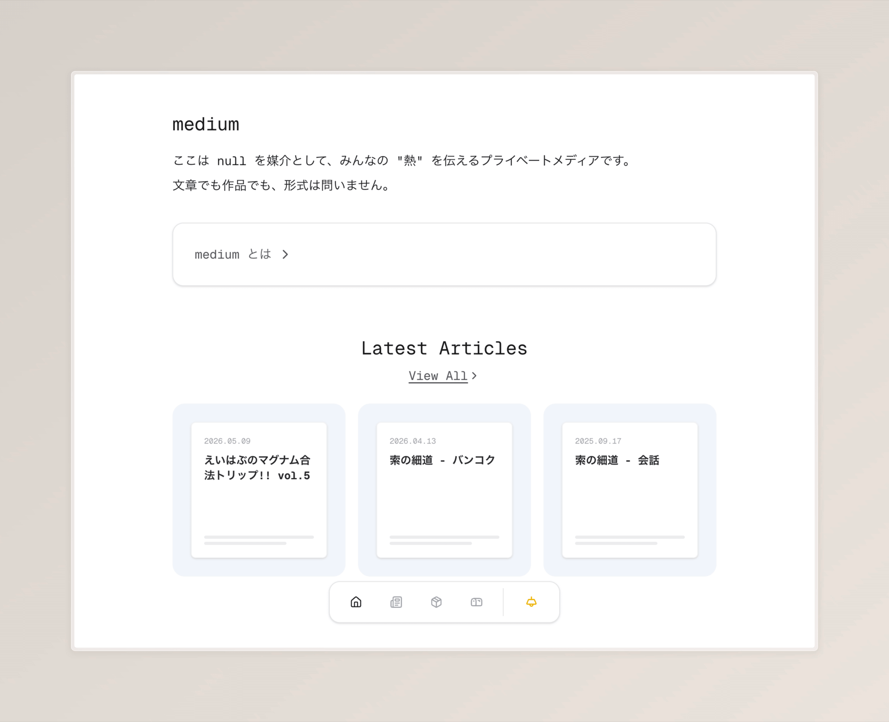
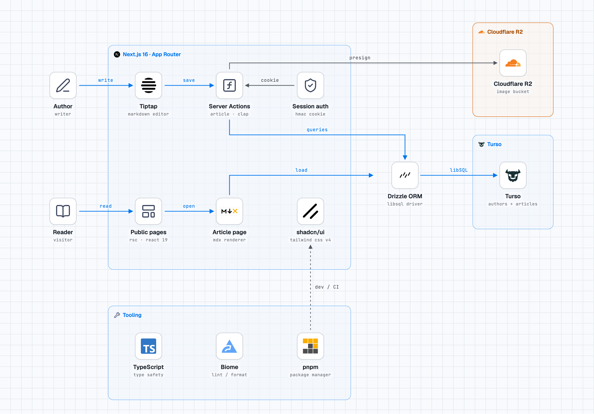
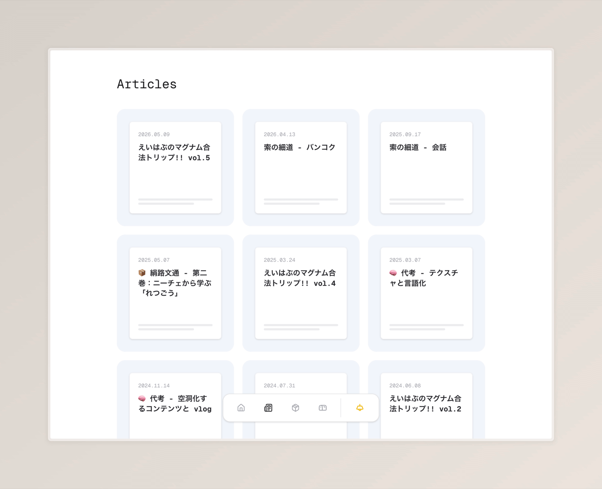
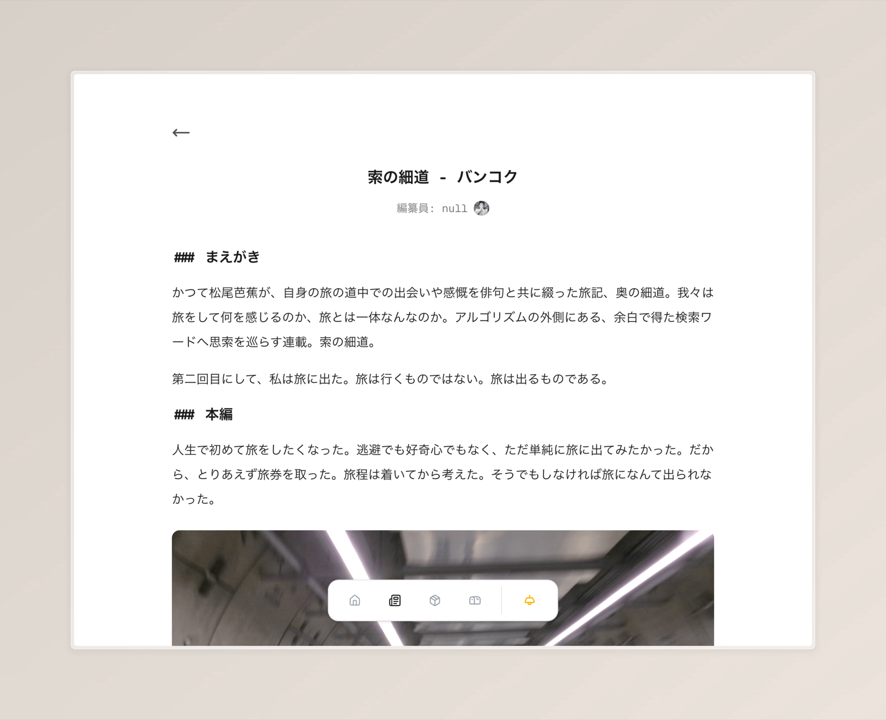
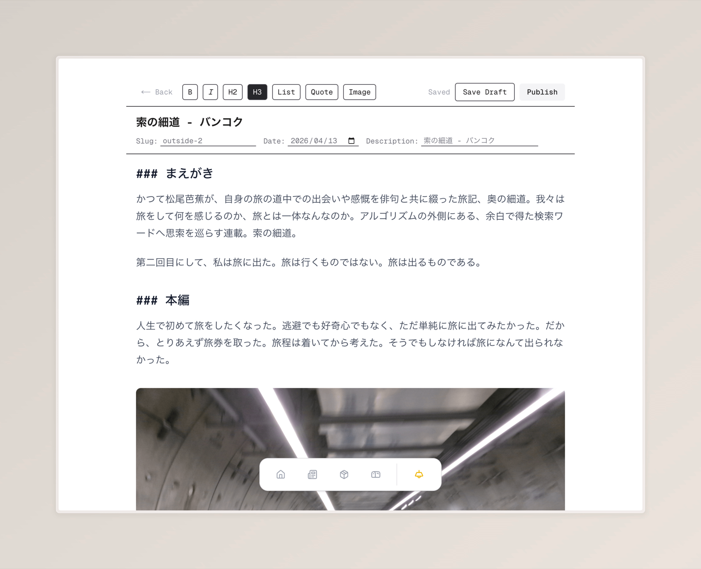

# medium

A small private blog. A few writers publish long-form articles; readers can clap, not comment. It has a rich-text editor, drafts, publishing, and direct image uploads.

**Live:** https://www.is-be.zip



## How it works



Authors and readers are on the left. Blue edges are the write and read paths: Tiptap → Server Actions → Drizzle → Turso. The `presign` edge is the only direct browser-to-R2 path, so image bytes never pass through the app server. Dashed edges are development tooling.

## Screenshots

*Articles*



*Article*



*Editor*



## Stack

| Layer | Choice |
| --- | --- |
| App | Next.js 16 (App Router, React Server Components, Server Actions, `use cache`) |
| UI | React 19, Tailwind CSS 4, shadcn/ui, next-themes |
| Editor | Tiptap 3 with `tiptap-markdown` |
| Content | `next-mdx-remote/rsc`, `remark-gfm` |
| Data | Turso (libSQL), Drizzle ORM |
| Auth | HMAC-SHA256 signed cookie (Web Crypto), bcryptjs |
| Images | Cloudflare R2 with S3 presigned uploads |
| Tooling | TypeScript, Biome, pnpm |

## Design decisions

### Writes through Server Actions, reads through RSC

All mutations are Server Actions colocated with the UI: saving and deleting articles, publishing, claps, login, and presigning uploads. There are no route handlers and no separate API client.

Reads call Drizzle directly from server components. `getAllPostsMeta` and `getPostBySlug` are wrapped in React `cache()` so a page can ask for the same data more than once without repeating the query. Both filter on `status = 'published'`, so drafts are only readable in the editor. The article body is rendered under `"use cache"`, and article writes invalidate it with `updateTag("articles")` plus `revalidatePath`.

Article content is stored twice: `content_json` is the editor's Tiptap document for round-tripping, and `content_mdx` is what the public page renders. The Markdown serializer keeps them aligned, but they can drift if a write bypasses the editor.

The trade-off is a single deployable with no public API. Another client that needs the same data would need a new HTTP boundary.

### A hand-rolled HMAC session

Login looks up the author by username, compares the password with bcrypt, and signs the author id and an expiry with HMAC-SHA256 over `EDITOR_SECRET`. The cookie value is `${authorId}.${exp}.${signature}`; the cookie is `httpOnly`, `SameSite=Lax`, `Secure` in production, and expires after 24 hours.

Every protected action re-verifies the signature and rejects expired tokens, and the comparison is timing-safe. There is no session table, so the server keeps no per-session state.

The trade-offs are deliberate and visible in the code:

- Tokens carry `exp` but not `iat`. The signature rejects them 24 hours after login, but there is no server-side revocation: deleting an author or changing a password does not invalidate tokens that were already issued. Rotating `EDITOR_SECRET` ends all sessions.
- All authors share one signing key. A leak allows anyone to mint a session for any author id.
- `EDITOR_SECRET` is read once at module load. If it is missing or shorter than 32 characters, session operations throw instead of falling back to a weak key.
- Login and claps have no rate limiting.

This is enough for a private, invite-only blog with a few trusted writers. It is not a general-purpose account system: there is no signup, role model, password reset, or account management UI.

### Presigned uploads to R2

The editor asks a Server Action for an upload URL. The action checks the session, builds a random key under `articles/images/`, and signs a `PUT` valid for 300 seconds. The browser sends the file directly to R2, then puts the returned public URL into the Markdown.

Image bytes never pass through the Next.js server, so uploads do not hit request-body limits or hold a serverless function open during the transfer. R2 credentials stay on the server; the client only sees a short-lived URL.

The bucket is publicly readable, and there is no delete path or orphan cleanup. Uploads are restricted to JPEG, PNG, WebP, and GIF by content type; the client still supplies that type, so the bucket policy remains the final guard.

### Turso and Drizzle

Turso's libSQL over HTTP works from serverless functions without a connection pool. Drizzle provides a typed schema and SQL-shaped queries with little runtime overhead.

Schema changes are applied with `drizzle-kit push`. There are no migration files in the repository, so there is no migration history to review or roll back.

### Compared with go-next

[go-next](https://github.com/un-null/go-next) takes the other side of the same boundary: a Go API (Echo, sqlc, PostgreSQL) and a React Router SPA. The HTTP API is explicit and reusable, and the backend can be tested on its own.

medium keeps the boundary inside Next.js: Server Actions for writes, RSC for reads, and no standalone API. There is less glue to maintain, but there is no documented API for another client; mutations are coupled to this app's forms.

The two repositories are deliberately different answers to "where does the server boundary go", not two versions of the same design.

## Running locally

This repository is a design record, not a reusable template. It runs against a private database and bucket, so the setup below is a short memo rather than a reproducible install.

Node.js 20.9+, pnpm, Turso, and an R2 bucket whose CORS rule allows `PUT` from the app origin. Copy `.env.example` to `.env.local` and fill it in.

```bash
pnpm install
pnpm exec drizzle-kit push
pnpm dev
```

There is no signup. Insert an author into `authors` with a bcrypt hash:

```bash
node -e "console.log(require('bcryptjs').hashSync(process.argv[1], 12))" 'replace-me'
```

`pnpm build` is the production check, `pnpm check` runs Biome, and there are no tests.

## Known limitations

The blog is single-tenant: no signup, roles, password reset, or account management UI.

- **`EDITOR_SECRET` is a single point of failure.** All authors share one signing key, so a leak lets anyone mint a session for any author id. It must be at least 32 characters; if it is missing or too short, session operations throw at runtime instead of failing at startup. If it leaks, rotate it and redeploy.
- **Sessions cannot be revoked.** Tokens expire 24 hours after login, but deleting an author or changing a password does not invalidate already-issued tokens. Only rotating the secret ends all sessions.
- **No rate limiting** on login or claps.
- **Images are public.** Uploads are limited to JPEG, PNG, WebP, and GIF, but there is no delete path or orphan cleanup.
- **MDX is trusted input.** Article bodies are rendered without sanitization. This is safe only because writes require an author session.
- **No automated tests or CI.** `pnpm check` runs Biome.
- **Schema changes use `drizzle-kit push`.** There are no migration files, so there is no migration history.
